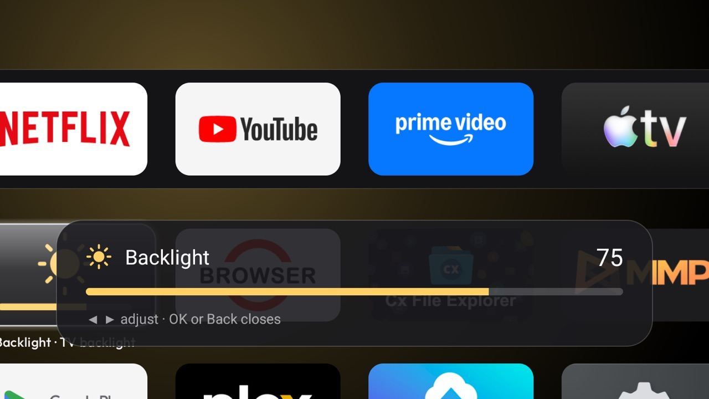

# Backlight

A quick slider for the TV's own panel backlight, the same value as **Settings → Picture → Backlight**, without
going into the TV's menus. For the [Clean Your TV](../../README.md) launcher it declares a
[module card](../../docs/modules.md): once you answer **Show card**, its tile reads "Backlight · TV backlight"
with a yellow glow. On any other Android TV home it is an ordinary app.



Opening it shows one slim glass panel at the bottom of the screen, over what was on screen:

| Key | What it does |
|---|---|
| ◀ ▶ | Backlight down or up: 5 at a time, 1 at a time at 10 and below. A value set in the TV's menu (43) lands back on the 5 grid on the first press. |
| OK, Back | Close. |
| (nothing for 4 seconds) | It closes by itself. |

The change shows on the panel at once. It is the TV's own setting, so the Picture menu shows the same number
afterwards and the TV keeps it after the slider closes.

Unlike the [Brightness](../brightness/) add-on, this moves the backlight itself rather than drawing a dark layer
over the picture. The panel gives off less light, and blacks get darker along with whites. The two work
together: lower the backlight here, and use Brightness for a night tint or to go below the panel's minimum.

## Which TVs

The backlight is read and written as the global setting `picture_backlight`, from 0 to 100, which MediaTek TV
boards keep for the Picture menu and apply when it changes. On a TV without that setting, the slider says so and
writes nothing, and `install.sh` stops before installing.

The slider never goes below 5. At 0 some panels go fully dark, and then the slider itself could not be seen to
bring it back.

## Permissions

| Permission | Why |
|---|---|
| `WRITE_SECURE_SETTINGS` | The backlight is a global setting, and only an app holding this may change one. It cannot be asked for on the TV, so `install.sh` grants it over ADB (`pm grant`). Without it, the slider shows the value and the grant command, and changes nothing. |

No internet permission, no background service, nothing at boot: the app runs only while the slider is on
screen. It writes this one setting and nothing else. No accounts, telemetry, ads or libraries.

## Build and install

You need JDK 17 and Android SDK platform 34 with build-tools 34.0.0, the same as for the launcher. From the repo
root, with ADB on:

```bash
TV_HOST=<tv ip> addons/backlight/install.sh
```

The script:

1. checks that the TV has the setting;
2. builds the app and installs it;
3. grants the permission and checks that the grant took;
4. opens the slider.

Then press Home: the launcher asks once whether to show the card. To build only, run
`cd addons/backlight && ./gradlew assembleRelease`. The JVM tests run with `./gradlew testReleaseUnitTest`.

To undo:

```bash
TV_HOST=<tv ip> tools/tv.py 'pm uninstall io.github.saiminhtet.backlight'
```

This removes the app. The backlight stays where you left it, and the TV's Picture menu still changes it.

## Opening it over a show

From a Home tile, the slider opens over the home screen. To open it over what is playing, put it on a remote
button with the launcher's `app_keys` (for example `"KEYCODE_PROG_YELLOW:io.github.saiminhtet.backlight"`,
see `launcher/app/src/main/res/values/config.xml`). That needs a key helper (`INPUT_KEY_SERVICE=1` or
`HOME_KEY_SERVICE=1`). PROMPT.md describes what a helper can cost on some TVs (held keys may stop repeating),
so check holding volume before and after.

## Limits

- **The backlight is saved for each picture mode.** Switching picture mode brings back that mode's own
  backlight. This follows the TV's own menu and was not tested here.
- **The slider is a translucent activity.** The app behind it pauses while the slider is open. Some streaming
  apps pause their video when that happens. Not yet checked over Netflix, Live TV or HDMI.
- **Menus drawn by the TV itself** (its own source or picture overlays) can show above the slider.

## Tested on

Sharp 4K Android TV (device `shilin`, MediaTek, Android TV 14, firmware UKNV.260806.001), over ADB, with this
repo's launcher. These were checked:

- the permission granted by `install.sh`;
- one ◀ writing 95 and four writing 80, one write per press, with the value holding afterwards;
- the panel dimming at once;
- the TV's Picture menu showing the same value;
- the real remote driving the slider down to the fine steps below 10 and back up;
- the slider closing by itself.

The JVM tests cover the steps, the fine steps, the snap back to the 5 grid, and the floor and top.

Still to check:

1. The slider over a streaming app, Live TV and an HDMI input (opened from a remote button).
2. The backlight across a picture-mode change and a reboot.

## Maintainer

[@saiminhtet](https://github.com/saiminhtet)
