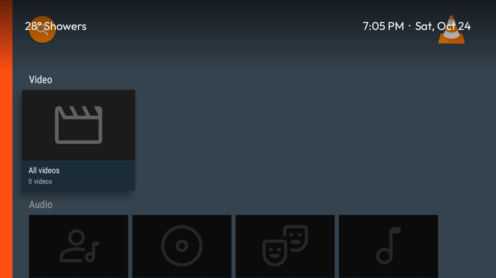

# Glance

The weather and the time over whatever you are watching. Press any button on the remote, and the weather fades in at the top left and the time and date at the top right, over a soft dark band along
the top of the picture, until 4 seconds after your last press. You don't need to go back to Home to see them. It works over Netflix, Live TV, HDMI inputs and
other apps, but never over Home, which shows both already.

For the [Clean Your TV](../../README.md) launcher it declares a [module card](../../docs/modules.md). Once you answer
**Show card**, its tile reads "Glance · Weather and time".



## How it behaves

- **When it shows:** on every press, held buttons included. It stays up while you keep pressing, and fades 4 seconds
  after the last press.
- **Your buttons:** every press still does its normal job in the app. Glance sees presses but never blocks one.
- **The weather:** the line comes from the [Weather](../weather/) add-on, built with its `home_status` option on.
  Without it, or once that line is more than 3 hours old, Glance shows the time and date only.
- **The time:** follows the TV's 12- or 24-hour setting, and the date follows its language.
- **On and Off:** open the Glance tile for one switch. **Off** stops Glance seeing keys at all, so the remote behaves
  as if it weren't installed.
- **After a restart or reinstall:** it starts showing once you switch apps, for example press Home and open Netflix
  again. Until then it doesn't know which app is in front, so it shows nothing rather than risk showing over Home.

## Permissions

| Permission | Why |
|---|---|
| Accessibility service (`GlanceService`) | To see remote presses, which it never blocks, and which app is in front, from window-change events: the package name only, never what is on screen. It draws the readouts itself as an accessibility overlay, so no "display over other apps" permission is needed. |
| `WRITE_SECURE_SETTINGS` | Granted over ADB by `install.sh`. Used only to put Glance's own service back in the enabled list when you open its tile after a force-stop, keeping every other entry. Nothing else is written. |

No internet permission: the weather comes from the Weather add-on on the TV. No background service of its own beyond
the accessibility service, nothing at boot, no accounts, telemetry, ads or libraries. The overlay window exists only
for the 4 seconds it shows.

## Install

You need JDK 17 and Android SDK platform 34 with build-tools 34.0.0, as for the launcher. Install the
[Weather](../weather/) add-on first, with `home_status` on. Then, from the repo root, with ADB on:

```bash
TV_HOST=<tv ip> addons/glance/install.sh
```

The script:

1. checks that the Weather add-on answers;
2. builds Glance and installs it;
3. grants `WRITE_SECURE_SETTINGS`;
4. switches the service on, keeping any service already enabled, such as the launcher's key helpers.

**Then hold Volume Up.** On some TVs, a service that sees keys stops held volume from ramping. The TCL G09 does this,
see `docs/devices/tcl-55p71b-g09-key-repeat.md`. If volume only moves one step per press, switch Glance off on its
tile.

**After a force-stop** (Settings → Apps, or a cleaner app), Android switches the service off for good. Open the Glance
tile and press OK on "Glance was stopped".

**Undo:**

```bash
TV_HOST=<tv ip> tools/tv.py 'pm uninstall io.github.saiminhtet.glance'
```

Android removes the service from the enabled list itself.

## Limits

- **Keys sent over ADB** (`input keyevent`) never reach it. Only the real remote shows the glance.
- **Some screens hide it.** Menus the TV draws itself, and Android's own permission dialogs, can sit above or hide
  accessibility overlays.
- **Netflix's player controls:** a press that brings up Netflix's controls also shows the glance. Its top band can sit
  over the top of those controls for the 4 seconds.

## Tested on

Sharp 4K Android TV (device `shilin`, MediaTek, Android TV 14, firmware UKNV.260806.001), with this repo's launcher and
the Weather add-on. The owner checked these with the real remote:

- the glance over a playing Netflix film, with the press still reaching Netflix;
- the glance on every press, fading 4 seconds after the last one;
- nothing over Home;
- held Volume Up still ramping.

Over Live TV and HDMI, the same accessibility overlay was confirmed with a prototype before this build.

## Maintainer

[@saiminhtet](https://github.com/saiminhtet)
